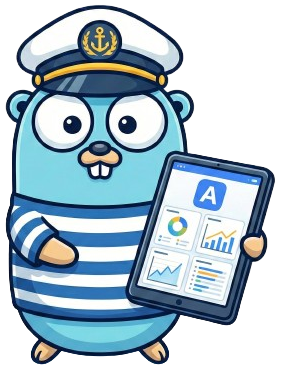

<p align="center">
  
</p>

<h1 align="center">AllureDeck</h1>
<p align="center">A modern dashboard for Allure test reports — Go API backend + React frontend.</p>

<p align="center">
  <a href="https://github.com/mkutlak/alluredeck/actions/workflows/release.yml"></a>
</p>

<p align="center">
  
</p>

## Features

- **Runs feed** — landing page listing CI runs across all project groups with a pass/fail verdict, branch and group filters kept in the URL, failures tagged new / inherited / environment, and a page per run
- **Project management** — create, rename, delete projects; parent/child grouping with drag & drop; Projects table with Grouped and All views and pass rates; paginated API
- **Analytics** — Status, Pass Rate and Duration trends, status distribution, failure categories, low-performing tests, flaky impact, top failure messages, suite pass rates, label breakdown
- **Test timeline** — interactive D3 Gantt chart of parallel test execution with zoom, minimap, and keyboard navigation
- **Build comparison** — diff two builds to see regressed / fixed / added / removed tests
- **Defects** — fingerprint-grouped failure tracking with bulk classification and per-build summaries
- **Known issues** — track known-failing tests by name with ticket links; matching failures are tagged in the runs feed
- **Pipeline runs** — aggregate CI runs across child projects by pipeline ID, falling back to commit SHA; parent projects show a Pipeline Runs tab
- **Report history** — colour-coded table with per-build stats, pagination, CI metadata, view and delete actions
- **Embedded report viewer** — Allure 2 & 3 reports rendered inline, with embedded Playwright trace viewer at `/trace/`
- **Attachments** — browse a build's attachments grouped by test, filter by type and test status, preview images, logs, and video
- **Playwright support** — upload Playwright HTML reports through the API alongside Allure; Playwright projects get a Playwright / Allure view toggle
- **AI failure summaries** — opt-in LLM hypothesis for a failing test in the runs feed (off by default)
- **MCP server** — optional `alluredeck-mcp` service for AI clients; read tools plus proposal-only writes that an admin approves
- **Webhooks** — Slack, Discord, Teams, and generic HTTP notifications with delivery tracking
- **API keys** — per-user `ald_` prefixed keys for CI/CD uploads (SHA-256 hashed, optional expiry)
- **Project actions** — ⋯ menu per project: send results (drag & drop), clean results, clean history; admin system monitor with job cancel and retry
- **Authentication** — local JWT login with refresh-token rotation, admin/editor/viewer RBAC, CSRF protection, per-IP rate limiting; optional OIDC SSO (Azure AD, Keycloak, Okta, Google Workspace)
- **Global search** — Cmd+K command palette over projects, tests, runs, and branches
- **Storage backends** — local filesystem and S3/MinIO (IRSA on EKS supported)
- **Dark / light mode** — system-aware theme toggle (Catppuccin)
- **Multi-arch images** — `linux/amd64` and `linux/arm64`

## Quick Start

### Docker Compose

```bash
git clone https://github.com/mkutlak/alluredeck.git
cd alluredeck
docker compose -f docker/docker-compose.yml up -d
```

| Service | URL |
|---------|-----|
| UI | <http://localhost:7474> |
| API | <http://localhost:5050> |
| MCP server | <http://localhost:8081> |
| PostgreSQL | `localhost:5432` |

> **Default credentials:** `admin` / `admin` (full access) and `viewer` / `viewer` (read-only) — change before exposing to any network.

### Helm

```bash
helm install alluredeck oci://ghcr.io/mkutlak/charts/alluredeck
```

See the [Helm Chart README](charts/alluredeck/README.md) for full configuration options.

## Documentation

- [Product Features](docs/features.md) — comprehensive feature guide with screenshots
- [Authentication](docs/authentication.md) — local auth, OIDC SSO, provider examples (Azure AD, Keycloak, Okta, Google)
- [User Management](docs/user-management.md) — Users page, roles, user lifecycle, and the Profile page
- [Security](docs/security.md) — sessions, brute-force throttle, rate limiting, CSRF, security headers, encryption at rest
- [Security policy](SECURITY.md) — supported versions and how to report a vulnerability
- [Deployment and Security](docs/deployment.md) — Docker Compose, Helm, JWT auth, RBAC, production checklist
- [Configuration Reference](docs/configuration.md) — all environment variables and YAML config
- [Storage](docs/storage.md) — local filesystem and S3/MinIO setup, IRSA on EKS
- [Async Uploads](docs/async-uploads.md) — streaming tar.gz uploads and job polling
- [Defects](docs/defects.md) — error fingerprinting, classification, and the defects API
- [Webhooks](docs/webhooks.md) — events, payloads, per-target examples, HMAC signing
- [Audit Log](docs/audit-log.md) — security-sensitive events in the `audit_log` table and how to query them
- [Observability](docs/observability.md) — OpenTelemetry traces, metrics, and trace-correlated logs
- [MCP Server Operations](docs/operations/mcp-server.md) — enabling the MCP server, tokens, proposals, rate limits
- [Helm Chart Reference](charts/alluredeck/README.md) — installation, PostgreSQL setup, and full `values.yaml` reference
- [Development Guide](docs/development.md) — local setup, mise tasks, testing, conventions

## Acknowledgements

AllureDeck is a rewrite of [fescobar/allure-docker-service](https://github.com/fescobar/allure-docker-service) + [allure-docker-service-ui](https://github.com/fescobar/allure-docker-service-ui).

## License

Apache 2.0
