# AllureDeck Features

AllureDeck is a self-hosted dashboard for Allure test reports. It provides a Go API backend and React frontend for managing projects, browsing report history, visualising test analytics, and embedding Allure 2 and 3 reports inline.

Related documentation: [Deployment & Security](deployment.md) · [Configuration Reference](configuration.md) · [Storage](storage.md) · [Authentication](authentication.md) · [Development Guide](development.md) · [Security](security.md) · [User Management](user-management.md) · [Async Uploads](async-uploads.md) · [Webhooks](webhooks.md) · [Defects](defects.md) · [Audit Log](audit-log.md) · [Observability](observability.md) · [MCP Server Operations](operations/mcp-server.md)

---

## Table of Contents

1. [Authentication & Access Control](#authentication--access-control)
2. [API Keys for CI/CD](#api-keys-for-cicd)
3. [Runs Feed](#runs-feed)
   - [Run Page](#run-page)
   - [AI Failure Summaries](#ai-failure-summaries)
4. [Projects Page](#projects-page)
5. [Project Management](#project-management)
   - [Project Hierarchy & Grouping](#project-hierarchy--grouping)
   - [Project Display Names](#project-display-names)
6. [Project Overview](#project-overview)
   - [Report History](#report-history)
7. [Analytics](#analytics)
8. [Known Issues](#known-issues)
9. [Defects](#defects)
10. [Test Execution Timeline](#test-execution-timeline)
11. [Attachments](#attachments)
12. [Test History](#test-history)
13. [Build Comparison](#build-comparison)
14. [Pipeline Runs](#pipeline-runs)
15. [Report Viewer](#report-viewer)
16. [Playwright Reports](#playwright-reports)
    - [Trace Viewer](#trace-viewer)
17. [Project Actions Menu](#project-actions-menu)
18. [Webhooks](#webhooks)
19. [Report Retention](#report-retention)
20. [Global Search](#global-search)
21. [Admin System Monitor](#admin-system-monitor)
22. [Navigation & UI](#navigation--ui)
23. [User Preferences](#user-preferences)
24. [Backend & Deployment](#backend--deployment)
25. [CI/CD Integration](#cicd-integration)
26. [Configuration Quick Reference](#configuration-quick-reference)

---

## Authentication & Access Control

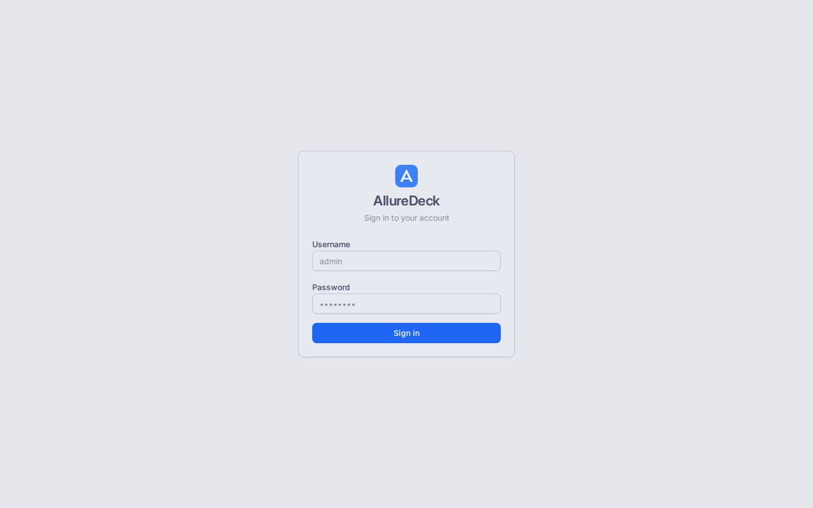

AllureDeck supports two authentication methods that can operate simultaneously:

1. **Local authentication** — static admin/viewer credentials via environment variables, plus password accounts created on the Users page (stored in the database)
2. **OIDC SSO** — OpenID Connect with any compliant identity provider (Azure AD, Keycloak, Okta, Google Workspace)

Local auth serves as a break-glass fallback when SSO is enabled. See [Authentication](authentication.md) for full OIDC setup.

**Roles (3-level RBAC):**

| Role | Level | Capabilities |
|------|-------|-------------|
| `admin` | 3 | Full access: create/delete projects, manage reports, manage users, system settings, API keys |
| `editor` | 2 | Upload results, generate reports, manage known issues, set default branches |
| `viewer` | 1 | Read-only: browse projects, view reports, view analytics, view known issues |

**Local auth configuration:**

| Environment Variable | Description | Default |
|---------------------|-------------|---------|
| `SECURITY_ENABLED` | Enable authentication and RBAC | `false` |
| `ADMIN_USER` | Admin account username | *(empty)* |
| `ADMIN_PASS` | Admin account password (bcrypt-hashed on startup) | *(empty)* |
| `VIEWER_USER` | Viewer account username | *(empty)* |
| `VIEWER_PASS` | Viewer account password | *(empty)* |
| `JWT_SECRET_KEY` | HMAC-SHA256 signing key for JWT tokens | `super-secret-key-for-dev` |
| `JWT_ACCESS_TOKEN_EXPIRES` | Access token lifetime in seconds | `3600` (1 hour) |
| `JWT_REFRESH_TOKEN_EXPIRES` | Refresh token lifetime in seconds | `2592000` (30 days) |

> **Important:** Change default credentials and generate a strong `JWT_SECRET_KEY` before exposing AllureDeck to any network. See [Deployment & Security](deployment.md) for production hardening.

**Public viewer mode:** Set `MAKE_VIEWER_ENDPOINTS_PUBLIC=true` to allow unauthenticated read-only access. Useful for public dashboards.

**OIDC SSO:** When enabled, the login page displays a "Sign in with SSO" button alongside the local login form. SSO uses Authorization Code + PKCE flow with JIT user provisioning and group-based role mapping. See [Authentication](authentication.md) for provider-specific setup.

---

## API Keys for CI/CD

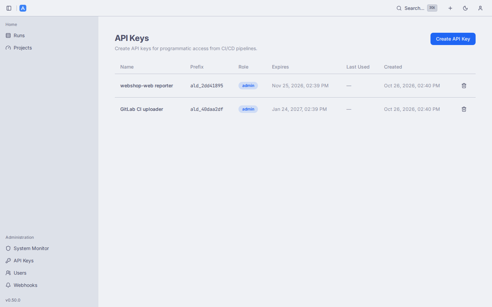

API keys allow programmatic access from CI/CD pipelines without exposing username/password credentials.

**Key properties:**
- Keys use the `ald_` prefix (64 hex characters, 32 bytes of entropy)
- Stored as SHA-256 hashes — the full key is shown only once on creation
- Inherit the creator's role (admin, editor, or viewer)
- Sent via `Authorization: Bearer ald_...` header
- Maximum 5 keys per user
- Optional expiry: presets of 30d, 90d (default), 180d, 1 year, or never, or a custom date

**Management:** Open **Administration → API Keys** in the sidebar, use "API Keys" in the user menu (top-right), or visit `/settings/api-keys`. The page lists each key's name, prefix, role, expiry, last use, and creation date; create and delete keys from there. The create dialog also has an **Allow MCP writes** checkbox, which lets the key create [MCP proposals](operations/mcp-server.md). Restricting a key to specific projects (`project_ids`) is available through the API only.

**CI/CD usage:**

```bash
# Upload results using an API key (no login step needed).
# The upload queues report generation; no separate "generate" call is needed.
curl -X POST "https://alluredeck.example.com/api/v1/projects/my-project/results" \
  -H "Authorization: Bearer ald_abc123..." \
  -F "files[]=@allure-results/result1-result.json"
```

---

## Runs Feed

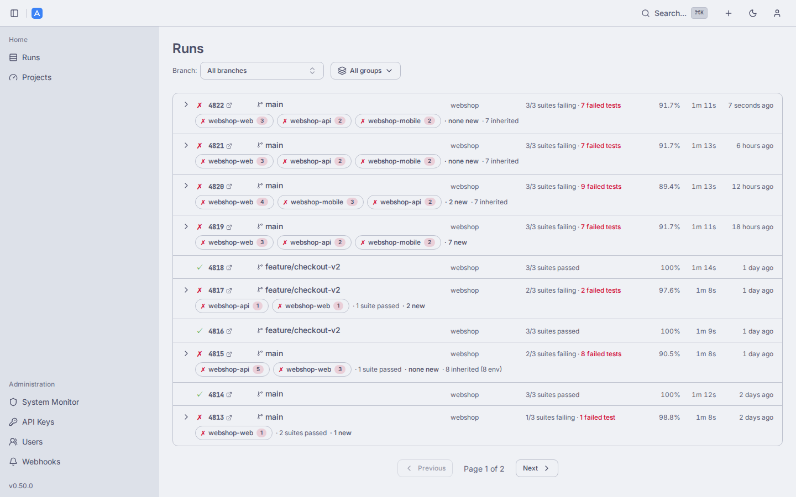

The Runs feed is the landing page after login (`/`, sidebar → Home → Runs). It lists CI runs across all [project groups](#project-hierarchy--grouping), newest first, so a developer can see whether their pipeline passed and what broke.

A **run** is everything the child projects of one group uploaded under the same CI pipeline ID (or the same commit SHA when no pipeline ID was sent). A run that uploaded several suites, or a suite sharded across parallel CI jobs, is one row. Only builds in child projects of a group appear; uploads to standalone projects do not. Uploads need `ci_pipeline_id` or `ci_commit_sha` (see [Pipeline Runs](#pipeline-runs)).

**Each row shows:**
- **Verdict glyph** — see the table below
- **Run ID** — the pipeline ID (links to the CI pipeline when a URL was sent) or the short commit SHA
- **Branch** — opens the [Run Page](#run-page)
- **Group** — the parent project, linked
- **Summary** — `2/9 suites failing · 14 failed tests`, `9/9 suites passed`, `all tests skipped`, or `awaiting 3 suites`
- **Pass rate**, **duration** (wide screens), and **relative time**
- When something failed: chips for the failing suites (first four, then `+N failing`), `· N suites passed`, and where the failures came from (`2 new · 3 inherited (1 env)`)

| Glyph | Verdict | When |
|-------|---------|------|
| ✓ | passed | every suite passed |
| ✗ | failed | a suite has failed tests, or its report could not be read |
| ○ | all skipped | every suite was skipped |
| ○ | awaiting | suites of the previous run have not uploaded yet (the verdict is withheld) |

Pass rate is `passed / (total − skipped)`, floored to a tenth of a percent, and `—` when nothing could be rated. A passing run is one line; expand a failing run with its chevron to list the failures.

**Awaiting suites:** While a run's newest upload is under 30 minutes old, the API compares it with the group's previous run and counts the suites that have not uploaded yet. The counts then cover only the suites that arrived, so the row says `awaiting N suites` instead of a verdict. The feed re-checks every 30 seconds while any visible run is awaiting.

**Merged shards:** When a suite is sharded and each shard uploads its own build under one pipeline ID, the shards merge into one suite. Failures from all shards are listed together, and each shard keeps its own report link (`#build`).

**Failure origins:** Each failing test is compared with the same test (by history ID) in the suite's baseline: the latest older build on the suite's own default branch that is not part of the run (all shards of that pipeline, if it had one).

| Origin | Meaning |
|--------|---------|
| `new` | the test passed in the baseline — likely caused by this change |
| `inherited` | the test already failed or broke in the baseline |
| `unknown` | the baseline cannot say: no default branch, no older build, or the test is absent or skipped there |
| `env` | the test's defect fingerprint is categorised `infrastructure`; counted as inherited, never as new |

When every failure is inherited (none is `unknown`) and all were listed, the origin list leads with `none new`: on the chips line in the feed, and after the failed-test count in the Run Page summary. It is withheld while suites are awaited, when a failing suite has no tests listed (its report could not be read), and when the failure list is truncated. Failures can also carry `flaky` (with retry count) and `known issue` badges.

**Failure list:** The expanded panel groups failures **by suite** (default) or **by error**; the choice is kept in your browser. Grouping by error merges failures from different suites that share a failure shape (same normalised message, failure phase, and deepest failed step); the group header shows the first error line and `in <failed step>`. Each row links the test name to its [Test History](#test-history) on the run's branch, shows its badges, and has an icon linking to the Allure report of the build. Grouped by suite, a row also shows its error text, clamped to two lines with "Show full error"; grouped by error, the group header carries the message and each row names its suite. Groups show eight rows, then `… N more`. If the API truncated the list (more than 500 failures), the panel says so and the origin counts cover only the listed failures.

**Filters:** A searchable **Branch** selector and a multi-select **Group** filter (shown when at least one group exists). The state lives in the URL, so Back from a run page and shared links land on the same view:

```
/?branch=main&group=12&group=15&page=2
```

A bare `/` applies the groups you last selected (stored as the `runsFeedGroupIds` [preference](#user-preferences)) and all branches; `group=all` forces every group. Changing a filter replaces the history entry and returns to page 1. The feed is paginated, 10 runs per page.

**Keyboard:** while focus is in the list, `j` and `k` move between rows.

### Run Page

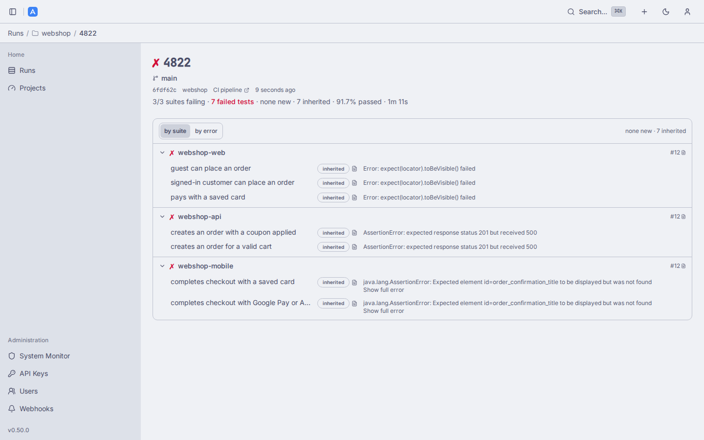

Each run has its own page at `/runs/{groupId}/{runKey}` — the link CI systems, MCP tools, and feed rows open. `runKey` is the pipeline ID, or the commit SHA when none was sent.

**Header:** verdict glyph and run ID, the full branch name, the short commit SHA (when the run has a pipeline ID), the group, a link to the CI pipeline, the time, and a summary line (`2/9 suites failing · 14 failed tests · 3 new · 11 inherited · 94.1% passed · 12m 4s`).

**Failing suites** come first, one open section each (`#suite-{projectId}` anchors, which the feed's suite chips link to), with the same by-suite / by-error toggle and failure rows as the feed. Suites that did not fail fold into one line (`7 suites passed · 1 skipped`); expand it to list each suite with its pass rate and duration, linked to its report (or to the project when the suite is sharded). A run with no failing suite shows its suites open.

A run that does not exist shows "Run not found" with a link back to the feed. While suites are awaited, the page refreshes every 30 seconds.

**API:**

| Method | Path | Description |
|--------|------|-------------|
| `GET` | `/api/v1/pipeline-runs` | The feed: runs across all groups. Query params: `page`, `per_page` (default 10), `branch`, `group_id` (repeatable) |
| `GET` | `/api/v1/projects/{project_id}/pipeline-runs/{run_key}` | One run of a group, with per-suite and aggregate statistics |
| `GET` | `/api/v1/projects/{project_id}/pipeline-runs/{run_key}/failures` | Failed and broken tests of the run, with `origin`, `environment`, `known`, `flaky`, `cluster_key`, and `failed_step`. Query param: `limit` (default 500) |

### AI Failure Summaries

**Opt-in, off by default.** When an operator enables an LLM backend (see [Configuration → AI Failure Summaries](configuration.md#ai-failure-summaries-llm)), each failing test row in the runs feed and on the Run page gains an **"AI summary"** expander. It shows a plain-language **hypothesis** for the failure, a suggested category, supporting **evidence**, and a link to the build where the test last passed — generated from the test's error, failed-step path, attachment text, and the diff against that last-good build.

The output is labelled an **"AI hypothesis"** and carries a **"verify before acting" disclaimer** — it is never treated as a verdict, and the suggested category is display-only (never written back to a defect). Summaries are cached per failure, generated only for tests with real failure evidence, and the endpoint is rate-limited. When the feature is disabled (the default), the expander is hidden and no external call is ever made. Point the LLM backend at a self-hosted OpenAI-compatible server to keep all failure data on-premises.

**API:**

| Method | Path | Description |
|--------|------|-------------|
| `GET` | `/api/v1/projects/{project_id}/builds/{build_id}/tests/{history_id}/failure-summary` | Cached-or-generated AI hypothesis for one failing test. Returns `{"enabled": false}` when the LLM backend is off |

---

## Projects Page

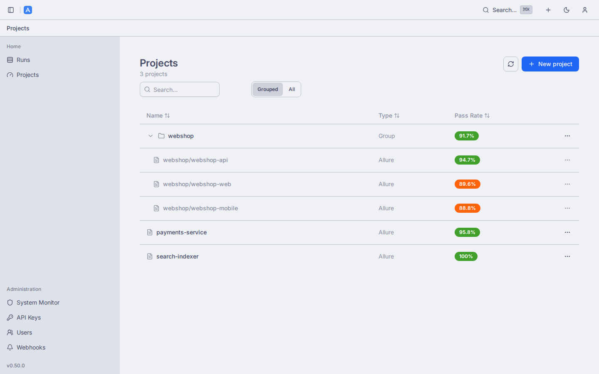

The Projects page (`/projects`, sidebar → Home → Projects) lists every project in a table. `/dashboard` redirects here.

**Columns** (click a header to sort):
- **Name** — project display name; group rows show a folder icon
- **Type** — `Allure`, `Playwright`, or `Group`
- **Pass Rate** — the latest build's pass rate (a group shows its aggregate), colour-coded: green >= 90%, orange 70-89%, red < 70%, `—` when nothing could be rated. Skipped tests are excluded from the denominator

**Controls:** a search box that filters by name, a **Grouped / All** toggle, a refresh button, and, for admins, **New project**. In **Grouped** mode (default) groups come first; a chevron expands a group's children in place, and clicking the group drills down (`/projects?group={id}`) to show only its children. **All** shows a flat list of standalone projects and group children; group rows are left out. Admins also get a ⋯ menu per row (see [Project Management](#project-management)).

---

## Project Management

Projects are the top-level organisational unit. Each project has a unique slug (e.g. `my-service`) used in API calls.

**Create a project:** Admins click **New project** on the Projects page or use the "Create new" (+) button in the top bar. The dialog takes a project ID and an optional parent project.

**Row actions (admin):** The ⋯ menu on a Projects-page row offers, for a project, **Rename project**, **Move to group…**, and **Delete project** (removes the project record and all associated reports from storage); for a group, **Clean all results** and **Clean all history**, which apply to every child.

### Project Hierarchy & Grouping

Projects can be organised into one-level **parent / child** relationships. A parent project acts as a group; its children are the actual test suites. This is useful when a single CI pipeline runs multiple suites (e.g. `api-tests`, `ui-tests`, `contract-tests`) and you want to aggregate them under one group — and then view them per run in the [Runs Feed](#runs-feed) and on the group's [Pipeline Runs](#pipeline-runs) tab.

**Rules:**
- Hierarchy is **exactly one level deep** — a parent cannot itself be a child, and a child cannot have its own children
- A project cannot be re-parented if it already has children (enforced server-side with `409 Conflict`)

**Projects page grouping:** In **Grouped** view (default) parent projects appear first with a folder icon and are not links — a chevron expands the group in place, and clicking the group drills down to show only that parent's children. Switch to **All** to see a flat list of standalone projects and children regardless of hierarchy; group rows are left out. Opening a parent project (from search or a run) lands on its Pipeline Runs tab.

**Drag & drop grouping:** On the Projects page, drag a project row onto a top-level project row to nest it; the target becomes a group once it has a child. While you drag a child, a "Drop here to remove from group" zone appears — drop on it to un-parent. A toast offers **Undo**. A project that already has children cannot be dragged. **Move to group…** in the row menu does the same without dragging. The underlying move calls `PUT /projects/{id}/parent` (to nest) or `DELETE /projects/{id}/parent` (to un-parent).

**API endpoints:**

| Method | Path | Description |
|--------|------|-------------|
| `PUT` | `/api/v1/projects/{project_id}/parent` | Set a project's parent. Body: `{"parent_id": <int>}`. Admin only |
| `DELETE` | `/api/v1/projects/{project_id}/parent` | Un-parent a project (returns `400` if it has no parent). Admin only |
| `GET` | `/api/v1/projects/{project_id}/children` | List direct children of a parent project (flat, not nested) |

### Project Display Names

Each project has a **slug** (the ID used in URLs and API calls, e.g. `ui-workflow`) and a `display_name` field that the UI shows in the Projects table, project page headers, and breadcrumbs. Creating a project sets `display_name` to the slug, and renaming sets both, so the two stay equal.

The UI labels a child project as `parent/child` through the `formatProjectLabel()` helper, which falls back to the slug when `display_name` is empty.

**Renaming:** The `PUT /api/v1/projects/{project_id}/rename` endpoint updates the slug and `display_name`. It also moves the storage path of a top-level project; a child project's storage key (its numeric ID) does not change.

---

## Project Overview

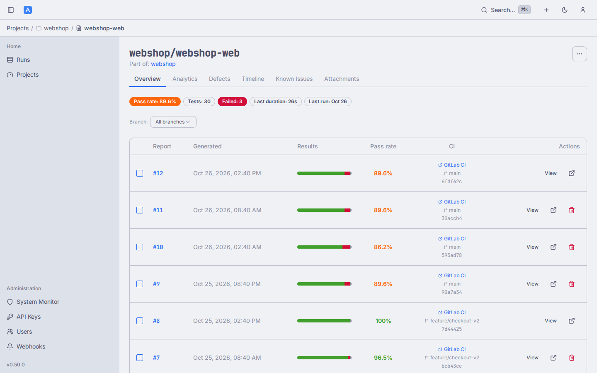

Opening a project lands on its Overview tab, a summary of the latest build on the selected branch. (A parent project has no Overview: its first tab is [Pipeline Runs](#pipeline-runs).)

**Stat chips:**
- **Pass rate** — passed / (total − skipped) of the latest build
- **Tests** — total test count
- **Failed** — failed plus broken count (shown when non-zero)
- **Last duration** — execution time of the latest run
- **Last run** — date of the latest report
- **Branch** — the selected branch, when one is set

**Cards** (each is hidden when it has nothing to show):
- **Environment** — name / value pairs from the build's `environment.properties`
- **Failure Categories** — Allure categories with failed / broken / total counts
- **Flaky Tests** — flaky tests of the latest build, with a "View flaky impact" link to [Analytics](#analytics)

**Branch filter:** A selector in the filter row above the report table lets you filter history by branch. All known branches are listed. The selection is shared with the Analytics and Timeline tabs.

### Report History

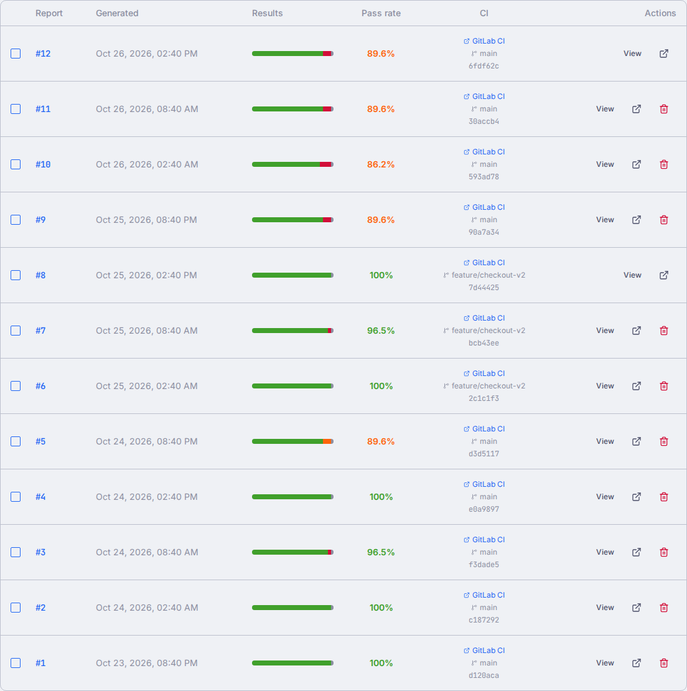

The paginated report history table shows all generated reports for the selected branch, most recent first.

**Columns:**
- *(checkbox)* — select two builds to compare
- **Report** — report number (links to the embedded report viewer); a clapperboard icon marks builds that also have a Playwright report
- **Generated** — timestamp of report generation
- **Results** — status distribution bar (passed / failed / broken / skipped)
- **Pass rate** — colour-coded: green >= 90%, orange 70-89%, red < 70%
- **CI** — execution context: CI provider (linked to the build), branch, and short commit SHA
- **Actions** — View (embedded), open in new tab, delete (admin only; the latest build cannot be deleted)

**Pagination:** Configurable rows per page (10 / 20 / 50 / 100) via a selector below the table. The per-page preference persists across navigation.

**Build selection for comparison:** Check two reports in the table to reveal a "Compare Selected" button that opens the [Build Comparison](#build-comparison) view.

---

## Analytics

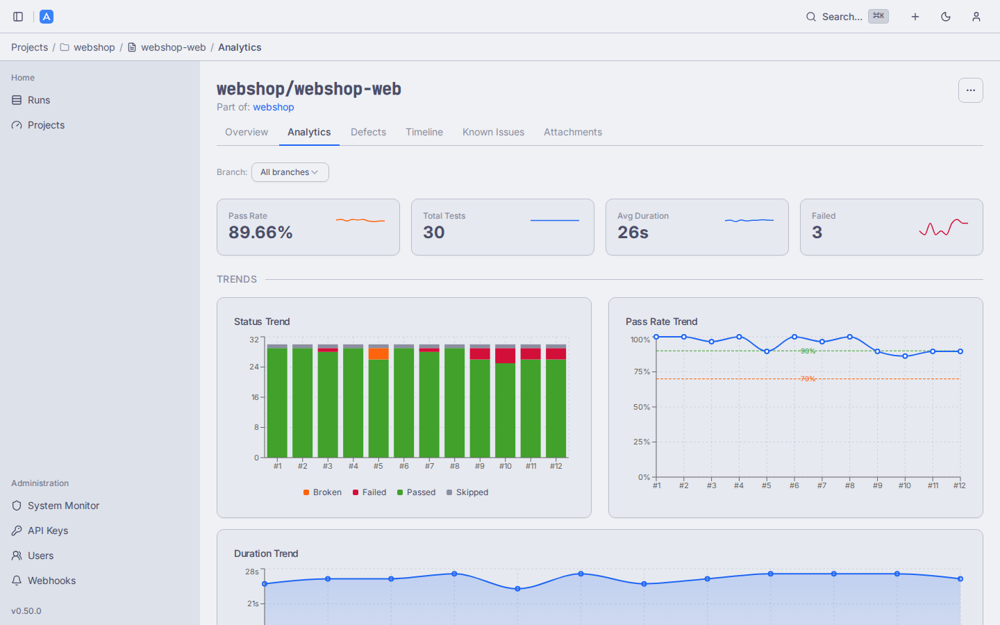

The Analytics tab surfaces trend charts and detail views for understanding test suite performance across builds. Analytics data is computed server-side and supports branch filtering via the branch selector in the filter row.

**KPI row:** Pass Rate, Total Tests, Avg Duration, and Failed, each with a sparkline of the last 10 builds.

**Trends:**
- **Status Trend** — stacked bar chart of passed / failed / broken / skipped counts per build
- **Pass Rate Trend** — line chart of pass rate over time with 90% (good) and 70% (warning) threshold lines
- **Duration Trend** — line chart of total test suite duration per build (dynamically formatted in human-readable units)

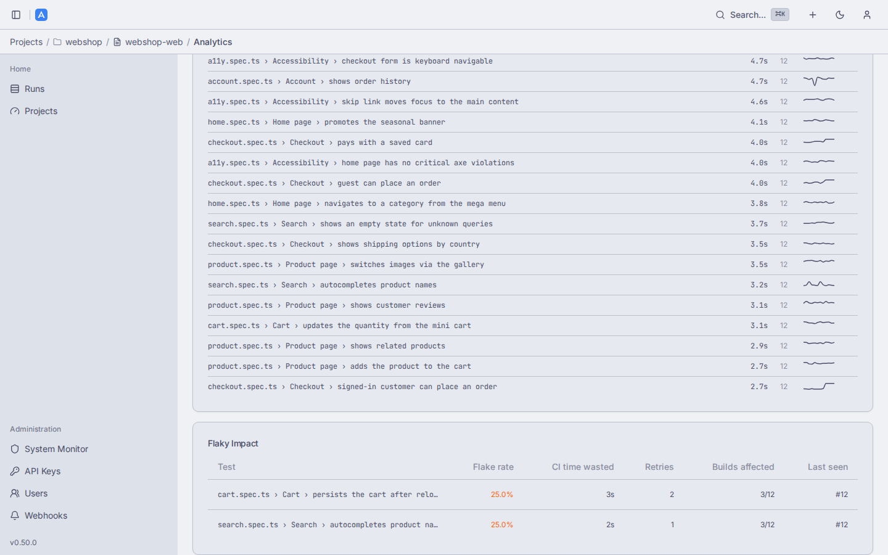

**Quality:**
- **Low Performing Tests** — table of the slowest and least-reliable tests with average duration or failure rate, build count, and sparkline trend; toggle between "Slowest" and "Least reliable" views
- **Flaky Impact** — the flakiest tests over the last 20 builds (top 10): flake rate, CI time wasted on retries, retry count, builds affected, and the last build each was seen in
- **Top Failure Messages** — the most frequent failure messages over the last 20 builds, with occurrence counts
- **Failure Categories** — categorised breakdown of failure reasons (from Allure categories.json)

**Distribution:**
- **Status Distribution** — donut chart of test result breakdown for the most recent build
- **Suite Pass Rates** — pass rate per suite over the last 20 builds
- **Label Breakdown** — donut chart of test counts by a label over the last 20 builds; pick `severity`, `feature`, `story`, or `owner`

---

## Known Issues

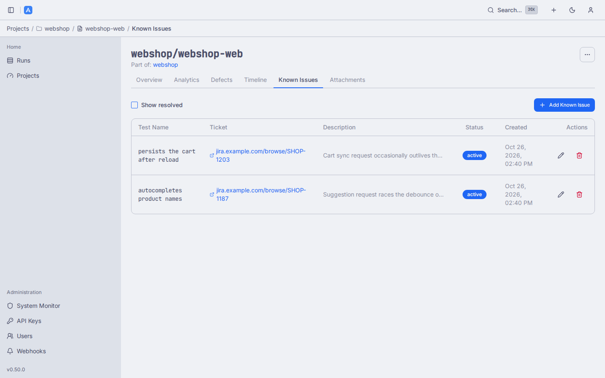

Known Issues lets you mark test cases that are currently broken by design — flaky tests, tests blocked by a known bug, or tests pending a fix.

**Features:**
- **Create / edit / delete** known issues with a test name, optional ticket URL, and optional description
- **Name matching** — a failing test is tagged `known issue` in the [Runs Feed](#runs-feed) and on the Run page when its name equals the name of an active known issue in its project. `GET /projects/{id}/reports/{report_id}/known-failures` splits a report's failures into known and new
- **Inline status toggle** — quickly resolve/reopen issues with a toggle button
- **Show resolved** toggle — view resolved issues alongside active ones
- "+ Add Known Issue" button available to editor and admin users

The API also accepts an optional `pattern` (a regular expression) on each known issue. It is not shown in the UI and is used by the [MCP server](operations/mcp-server.md) when matching failures.

---

## Defects

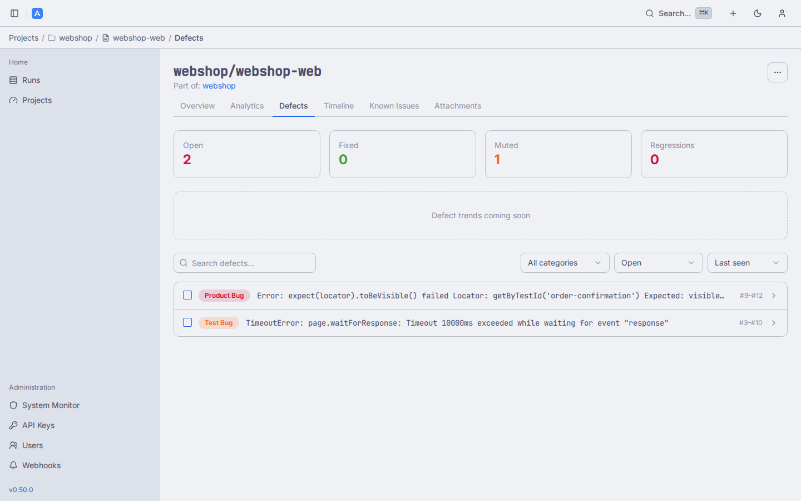

Defects group repeat test failures by **error fingerprint**, so a cluster of tests failing with the same root cause appears as a single tracked item that you can classify and triage — separate from Known Issues (which is about individually-tagged tests).

Each defect has a fingerprint, a category (`product_bug`, `test_bug`, `infrastructure`, `to_investigate`), a resolution (`open`, `fixed`, `muted`, `won't fix`), first/last seen build, occurrence count, and an optional link to a Known Issue.

The project-level view (the **Defects** tab) shows summary stat cards (Open, Fixed, Muted, Regressions), a build trend chart, and a filterable/sortable/paginated table. Clicking a row opens an inline detail drawer. Bulk actions let you set category or resolution across many defects at once. A build-scoped view at `/projects/{id}/builds/{buildId}/defects` shows only defects from a specific build; nothing in the UI links to it yet.

See [Defects](defects.md) for the full fingerprinting explanation, field reference, filter options, and API endpoints.

---

## Test Execution Timeline

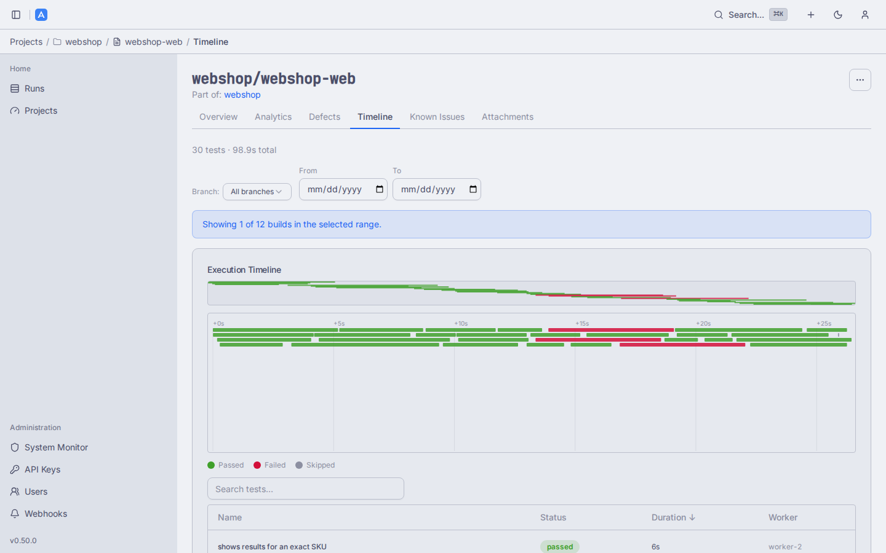

The Timeline tab renders an interactive D3.js-powered Gantt chart of the latest test run, visualising how tests were distributed across parallel workers. Filters above the chart select the branch and, with a date range, the number of builds to include.

**Features:**
- **Zoomable SVG chart** — pan and zoom to inspect individual tests in large suites (400+ tests)
- **Minimap** — compressed overview bar at the top with a brush control for viewport selection
- **Colour coding** — bars are coloured by test status: green (passed), red (failed), orange (broken), grey (skipped)
- **Hover tooltip** — shows test name, status badge, duration, and worker
- **Status legend** — displays only the statuses present in the current run
- **Detail table** — sortable and searchable table below the chart with columns: Name, Status, Duration, Worker. Default sort is by duration (slowest first). Clicking a row highlights the test in the chart
- **Keyboard accessibility** — arrow keys pan, +/- zoom, Home resets view, Escape clears selection
- **Summary header** — total test count and wall-clock duration

This view is especially useful for identifying bottlenecks in parallel test suites or workers that are significantly under-utilised.

---

## Attachments

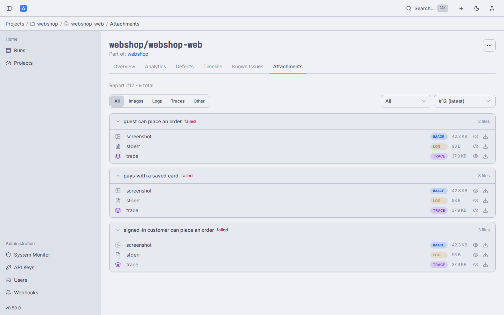

The Attachments tab (`/projects/{id}/attachments`) lists the files attached to a report's tests — screenshots, logs, videos, and Playwright traces — grouped by test. Parent projects do not have this tab.

**Features:**
- **Report picker** — defaults to the latest report; choose any other report from the dropdown
- **Filters** — by type (All / Images / Logs / Traces / Other) and by the test's status (All / Passed / Failed / Broken / Skipped)
- **Test groups** — each group shows the test name, its status, and file count, and collapses
- **Rows** — file name, a type badge (`IMAGE`, `LOG`, `TRACE`, `VIDEO`, `OTHER`), size, and **View** and **Download** actions
- **Preview** — View opens images, video, and text, JSON, and XML files in a lightbox; Playwright trace archives open in the [Trace Viewer](#trace-viewer)

**API:**

| Method | Path | Description |
|--------|------|-------------|
| `GET` | `/api/v1/projects/{project_id}/reports/{report_id}/attachments` | Attachments grouped by test. Query params: `mime_type` (prefix), `test_status`, `limit`, `offset` |
| `GET` | `/api/v1/projects/{project_id}/reports/{report_id}/attachments/{source}` | The attachment file (`?dl=1` to download) |

---

## Test History

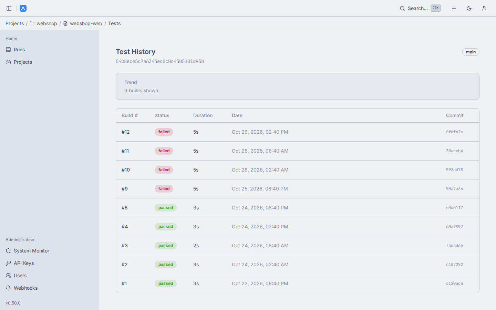

The Test History page (`/projects/{id}/tests?history_id={history_id}&branch={branch}`) shows the cross-build execution history of a single test case. There is no Tests tab: open it from a failing test's name in the [Runs Feed](#runs-feed) or on the [Run Page](#run-page), which pass the test's history ID and the run's branch.

**Features:**
- One row per build where the test appeared: build number, status (with a flaky badge and retry count), duration, date, and short commit SHA
- Scoped to the branch in the URL (shown as a badge); omit `branch` for all branches
- A count of the builds shown

The data comes from `GET /api/v1/projects/{project_id}/tests/history?history_id=…&branch=…&limit=…`.

---

## Build Comparison

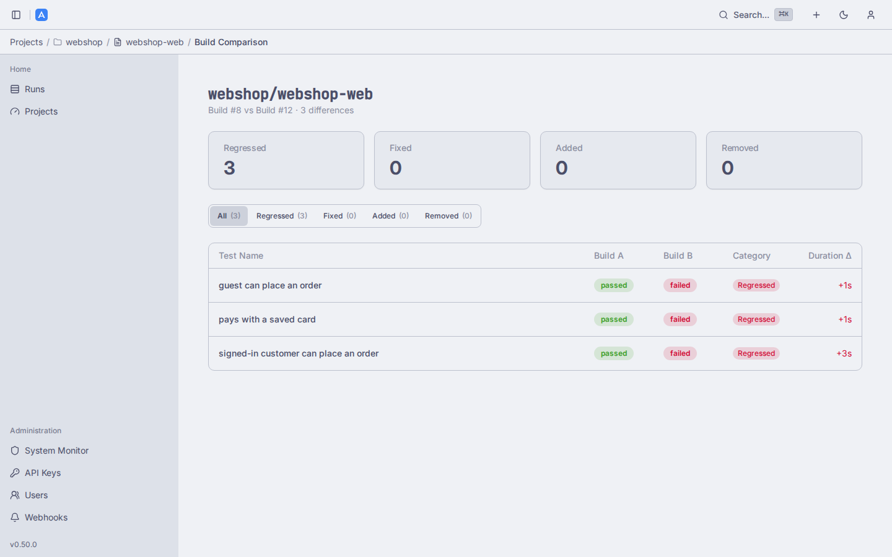

Select two builds from the Report History table and click "Compare Selected" to open the diff view (`/projects/{id}/compare?a={buildA}&b={buildB}`).

**Summary cards:**
- **Regressed** — tests that passed in Build A but failed/broken in Build B
- **Fixed** — tests that failed/broken in Build A but passed in Build B
- **Added** — tests present in Build B but not in Build A
- **Removed** — tests present in Build A but not in Build B

**Filter tabs:** Click any category card to filter the table to that subset. The "All" tab shows everything.

**Table columns:** Test Name, Build A status, Build B status, Category (Regressed / Fixed / Added / Removed), Duration delta.

---

## Pipeline Runs

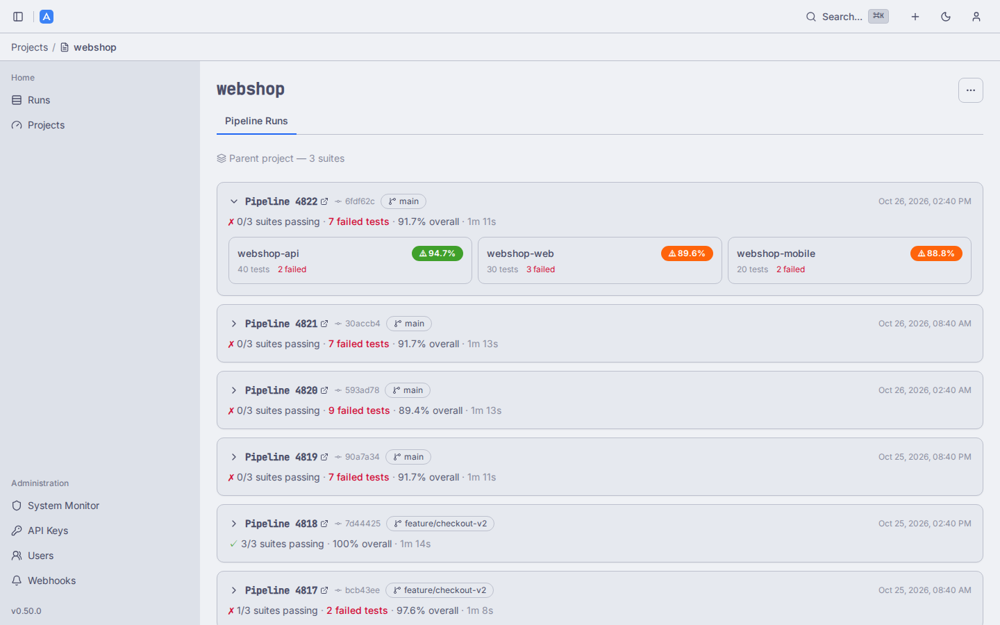

Pipeline Runs is the only tab of a **parent project** (see [Project Hierarchy & Grouping](#project-hierarchy--grouping)). It shows the same runs the [Runs Feed](#runs-feed) lists, scoped to one group: every child project's builds, grouped by **CI pipeline ID**, falling back to the **commit SHA** when a build has no pipeline ID.

Typical use case: a single CI pipeline runs `API tests` and `UI tests` as separate child projects under a `my-service` parent. When a pipeline finishes, the Pipeline Runs tab shows one card for it with both suites and a cross-suite aggregate.

**When the tab appears:** Only on parent projects that have at least one child project. A parent shows no other tab: Analytics, Defects, Timeline, Known Issues, and Attachments are hidden, and the index page is labelled Pipeline Runs in place of Overview. Child and standalone projects do not have this tab.

**Run cards** (a list, newest first):
- **Header** — `Pipeline {id}` (linked to the CI pipeline when a URL was sent) with the short commit SHA, or just the short SHA (linked to the CI build) when there is no pipeline ID; a branch badge; the timestamp
- **Summary line** — verdict glyph (see the [Runs Feed](#runs-feed) table), `N/M suites passing` or `awaiting N suites`, the failed-test count (or the failing-suite count when a suite's report could not be read), the overall pass rate, and the duration
- Click a card to expand a grid of its suites: suite name, pass-rate badge with status icon, test count, and failed count. Each suite links to the child project

**Filters:** The tab has no branch selector of its own; it applies the branch saved with your preferences when that branch exists in the group. Paginated, 10 runs per page.

**Prerequisite:** Child project uploads must carry CI metadata, as query parameters on `POST /projects/{id}/results`: `ci_pipeline_id` (and optionally `ci_pipeline_url`), and/or `ci_commit_sha`, plus `ci_branch`. Without a pipeline ID or a commit SHA, builds can't be grouped into a run.

**API:**

| Method | Path | Description |
|--------|------|-------------|
| `GET` | `/api/v1/projects/{project_id}/pipeline-runs` | Paginated pipeline runs (parent projects only; returns 400 otherwise). Query params: `page`, `per_page`, `branch` |
| `GET` | `/api/v1/projects/{project_id}/pipeline-runs/{run_key}` | One run of the group |
| `GET` | `/api/v1/projects/{project_id}/pipeline-runs/{run_key}/failures` | Failed and broken tests of the run |
| `GET` | `/api/v1/pipeline-runs` | Runs across all groups (the feed). Query params: `page`, `per_page`, `branch`, `group_id` (repeatable) |
| `GET` | `/api/v1/projects/{project_id}/builds/{build_id}/tests` | Failed and broken tests of one build. Query param: `limit` (default 50) |

---

## Report Viewer

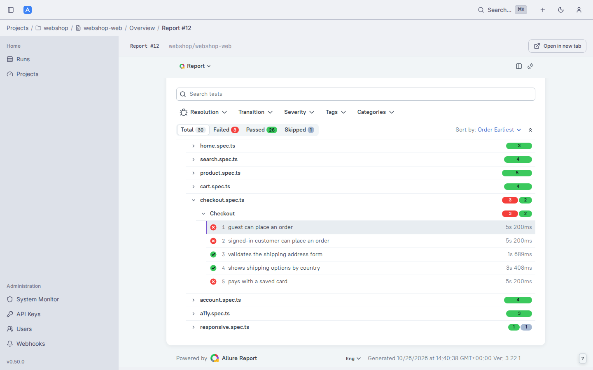

AllureDeck embeds test reports directly in the dashboard via an iframe (`/projects/{id}/reports/{reportId}`). The viewer renders either an Allure report or a Playwright HTML report depending on the project's `report_type`, which is auto-detected when results are uploaded.

**Features:**
- Supports both **Allure 2** and **Allure 3** report formats (auto-detected)
- Also supports **Playwright HTML reports** — see [Playwright Reports](#playwright-reports)
- **Breadcrumb** — `Projects / project / Overview / Report #N` in the bar under the top bar, with links back
- **Report #N** button — returns the embedded report to its home page
- **Open in new tab** — button to open the raw report in a standalone browser tab
- For Playwright projects, a **Playwright / Allure** toggle in the toolbar switches between the two views of the same build
- The embedded Allure report includes all standard Allure features: test results tree, quality gates, global attachments, global errors, retries, flaky test indicators

---

## Playwright Reports

AllureDeck accepts full Playwright HTML reports alongside Allure results. A single project can store both formats on the same build, and attached Playwright traces open inline in an embedded trace viewer — no download required.

**Uploading a Playwright report:**

Playwright reports are uploaded through the API as a **gzipped tar archive** (`tar -czf report.tar.gz -C playwright-report .`) whose root contains `index.html`. The API endpoint is:

```bash
curl -X POST "https://alluredeck.example.com/api/v1/projects/my-project/playwright?ci_branch=main&ci_commit_sha=$GITHUB_SHA" \
  -H "Authorization: Bearer $ALLUREDECK_API_KEY" \
  -H "Content-Type: application/gzip" \
  --data-binary @report.tar.gz
```

The `Content-Type` must be `application/gzip` (`application/x-gzip` and `application/x-tar+gzip` also work); any other value returns `400`.

Supported query parameters: `build_number` (pair with an existing build; defaults to the latest), `ci_branch`, `ci_commit_sha`, `ci_pipeline_id`, `ci_pipeline_url`, `execution_name`, `execution_from` (for CI metadata), and `force_project_creation=true` + `parent_id` to auto-create missing projects.

On upload the server streams, validates (max 10,000 files, path traversal rejected), and stores the archive under `playwright-reports/{buildNumber}/` in local storage or S3. The build is then marked with `has_playwright_report=true`.

**Viewing a Playwright report:**

Navigate to the report via the normal report history table (`/projects/{id}/reports/{reportId}`). The Report Viewer detects the project's `report_type` and points its iframe at the Playwright report (`/api/v1/projects/{id}/playwright-reports/{reportId}/index.html`) instead of the Allure one.

For Playwright projects, a **Playwright / Allure** toggle in the viewer toolbar switches between the two views of the same build.

### Trace Viewer

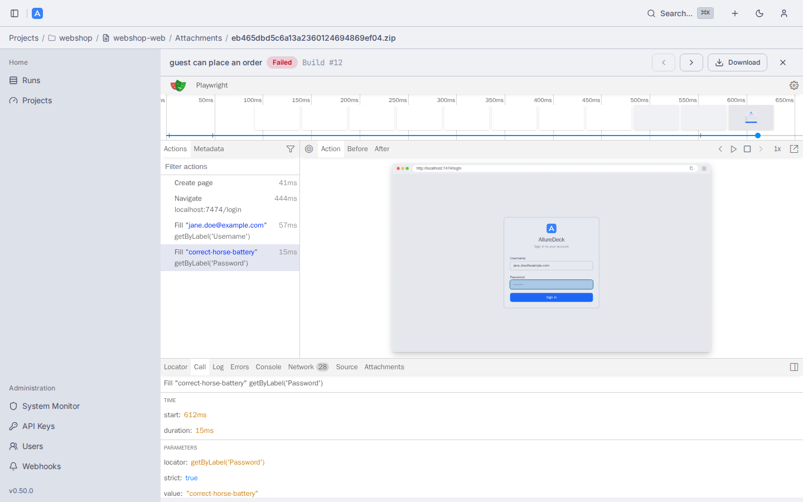

Playwright `trace.zip` files attached to a test render inline in AllureDeck's **embedded trace viewer** — no download required. The trace viewer is served as static assets from `/trace/` (populated at build time from `playwright-core`). Open a trace from the [Attachments](#attachments) tab (rows with a `TRACE` badge): the UI route `/projects/{id}/trace/{source}?reportId={reportId}` embeds `/trace/index.html` and injects the trace file URL as a query parameter. The page header shows the test name, its status, and the build, with **previous / next trace** buttons for the build's other traces, **Download**, and **Close**.

No authentication is required to load `/trace/` (it's pure static HTML/JS), but the trace file URL it opens resolves through AllureDeck's authenticated attachment endpoint, so traces remain protected by the normal access controls.

**API endpoints:**

| Method | Path | Description |
|--------|------|-------------|
| `POST` | `/api/v1/projects/{project_id}/playwright` | Upload a Playwright HTML report (gzipped tar, raw body) |
| `GET` | `/api/v1/projects/{project_id}/playwright-reports/{reportID}/{rest...}` | Serve the static Playwright HTML report (viewer+, cached) |

The embedded trace viewer static assets live under `/trace/` on the server and are populated at build time via `scripts/fetch-trace-viewer.sh`, which installs `playwright-core` via npm and copies `lib/vite/traceViewer` into the Go `api/static/trace/` embed.

---

## Project Actions Menu

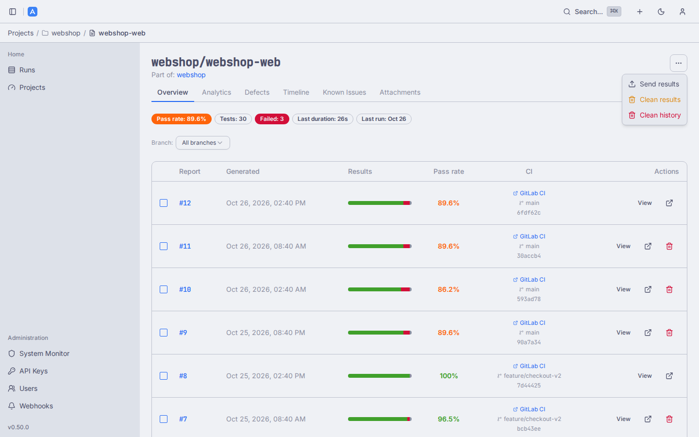

The ⋯ **Project actions** button sits in the page header of every project, next to the tabs. It is visible to editors and admins; viewers do not see it. Entries depend on the user's role and the project type:

| Item | Action | Minimum Role |
|------|--------|-------------|
| **Send results** | Upload Allure result files (.json, .xml, attachments, or a tar.gz) via drag & drop. Not shown for Playwright projects | editor |
| **Clean results** | Delete all pending result files for this project | admin |
| **Clean history** | Delete all generated reports and report history for this project | admin |

Uploaded results are turned into a report automatically.

### Send Results Dialog

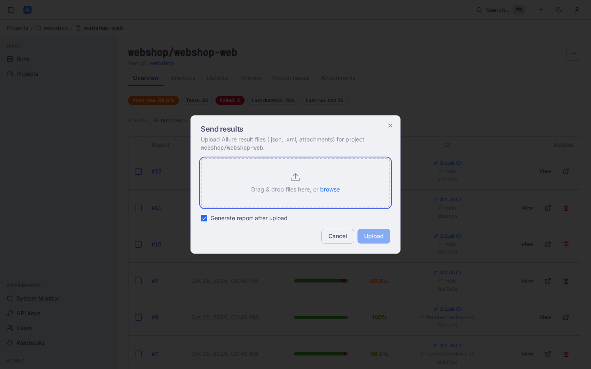

Choosing "Send results" opens a modal with a drag-and-drop drop zone. You can also browse for files. The dialog uploads the selected files as multipart form-data; a single `.tar.gz` / `.tgz` file is sent as a gzip body and extracted by the server. Every upload already queues a report, whatever the dialog does. With the "Generate report after upload" checkbox ticked (the default), the dialog also calls generate once the upload finishes, which queues a second job, and it shows progress for that job; unticking the box does not stop the upload's own report.

**Async tar.gz upload (CI/CD):** Large archives can be uploaded with `?async=true` to receive a `202 Accepted` response immediately while a background worker processes the archive. See [Async Uploads](async-uploads.md) for the full curl example and polling pattern.

---

## Webhooks

Webhooks send outbound notifications when report generation finishes, a report job fails, or a defect regresses, letting you surface test results directly in Slack, Discord, Microsoft Teams, or any custom HTTP endpoint.

Manage webhooks at `/settings/webhooks` (**Administration → Webhooks**, editors and admins). Each webhook belongs to a project, and a project can have up to **10 webhooks**.

**Target types:**

| Target | Description |
|--------|-------------|
| `slack` | Slack Incoming Webhook — payload rendered as a Slack message block |
| `discord` | Discord Channel Webhook — payload rendered as a Discord embed |
| `teams` | Microsoft Teams Incoming Webhook — payload rendered as a MessageCard |
| `generic` | Any HTTPS endpoint — receives a signed JSON payload (HMAC-SHA256 header if a secret is set) |

**Event subscriptions:** A webhook subscribes to one or more events via the `events` array:

| Event | Sent when |
|-------|-----------|
| `report_completed` | A report finishes generating (every build) |
| `report_failed` | A report finishes generating and the build has at least one failed test, or a report job fails after exhausting its retries |
| `regression_detected` | A report finishes generating and at least one defect regressed in that build |
| `digest` | Once every 24 hours, for each project that had a defect regression in the previous 24 hours |

Each build produces one delivery per webhook: the most specific triggered event it subscribes to wins, in the order `regression_detected` > `report_failed` > `report_completed`. The UI form has no events field and always creates webhooks that subscribe to `report_completed`; set `events` through the API to subscribe to the others.

**Create / edit form fields:**
- **Name** — display label
- **Target type** — one of the four above
- **URL** — the webhook endpoint (validated for SSRF — private, loopback, and RFC1918 addresses are rejected when you save it, and checked again when each delivery connects, so DNS changes cannot redirect it to an internal address)
- **Secret** *(optional, generic only)* — used to sign the payload with HMAC-SHA256
- **Custom template** *(optional)* — override the default payload body
- **Active** — toggle without deleting

**Security:** Webhook URLs and secrets are encrypted at rest. URLs are masked in API responses (e.g., `https://hooks.slack.com/****`). Secrets are never returned.

**Test send:** Each webhook row has a "Send test" action that queues a synthetic `report_completed` delivery so you can verify wiring before a real build.

**Delivery history:** Click the history action on a webhook row to see the last deliveries with status code, response body (truncated), error message, attempt number, and duration in milliseconds. Entries are ordered newest first and paginated.

See [Webhooks](webhooks.md) for the full payload shape, per-target examples (Slack, Discord, Teams, generic), HMAC signing details, and the complete API reference.

---

## Report Retention

AllureDeck supports two retention strategies that work together. A build is deleted if it exceeds **either** limit. The latest build per project is never deleted by either strategy.

| Strategy | Environment Variable | Default | Description |
|----------|---------------------|---------|-------------|
| **Count-based** | `KEEP_HISTORY_LATEST` | `100` | Maximum number of historical reports to keep per project. Set to `0` to disable count-based pruning (unlimited) |
| **Age-based** | `KEEP_HISTORY_MAX_AGE_DAYS` | `0` (disabled) | Delete reports older than N days. Set to `0` to disable age-based pruning |

**Stale-branch garbage collection:** When age-based pruning is enabled (`KEEP_HISTORY_MAX_AGE_DAYS` > 0), AllureDeck also removes entire non-default branches — their builds and the branch entry itself — once the branch's most recent build is older than the age cutoff. This keeps the branch selector dropdown from accumulating branches that stopped reporting long ago. The default branch is never removed, and a branch row is only dropped once none of its builds remain. The GC is batched: each sweep processes at most 50 stale branches, each in its own short transaction, so a large backlog drains incrementally across sweeps instead of requiring one oversized transaction (which databases with an aggressive `lock_timeout` would cancel forever).

**Orphan branch cleanup:** Branch entries that no build references (left behind by a failed upload, or by prunes that predate branch-row GC) are deleted on every scheduler sweep, regardless of which retention strategies are enabled.

A **background scheduler** runs all of the above (count-based pruning, age-based pruning, stale-branch GC, and orphan branch cleanup) for every project. It runs an immediate sweep on API startup, then repeats every 24 hours, and respects graceful shutdown.

Set `KEEP_HISTORY=false` to disable report history entirely (only the latest report is kept).

---

## Global Search

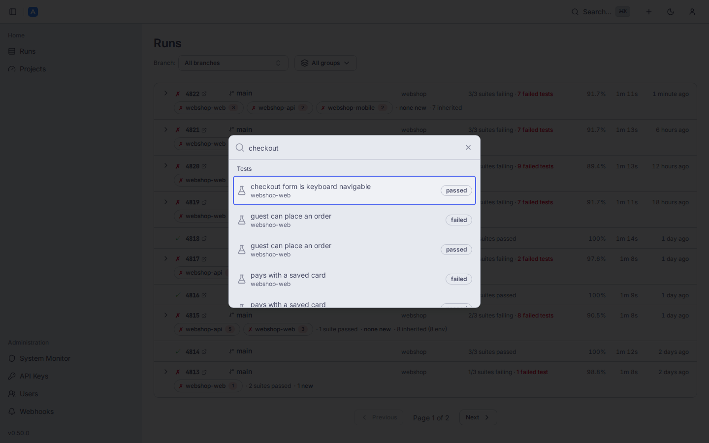

Press **Cmd+K** (macOS) or **Ctrl+K** (Linux/Windows), or click **Search** in the top bar, to open the search palette from anywhere in the app. Search is global: it is not scoped to the current project.

Type at least 2 characters. Results are grouped by type and navigable with arrow keys. Press Enter to open or Escape to close.

| Group | Matches | Opens |
|-------|---------|-------|
| **Projects** | project slugs containing the text (case-sensitive) | the project |
| **Tests** | test names in each project's latest build, using PostgreSQL full-text search (GIN-indexed tsvector); each result shows its project and status | the test's project |
| **Runs** | a pipeline ID, exact match | the [Run Page](#run-page) |
| **Branches** | branch names of group builds containing the text (case-insensitive) | the [Runs Feed](#runs-feed) filtered to that branch |

The API is `GET /api/v1/search?q=…&limit=…` (default 10 results per group, maximum 50).

---

## Admin System Monitor

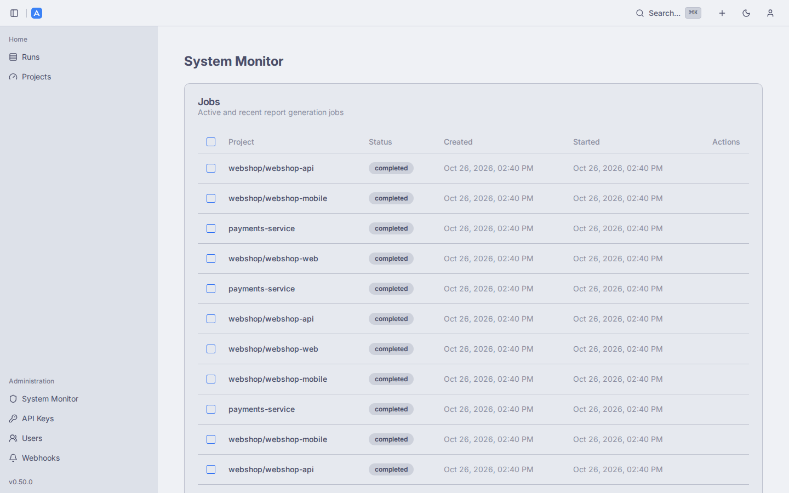

Accessible via **Administration → System Monitor** in the sidebar (admin only), this page provides operational visibility into background job activity.

**Jobs table:**
- Lists active and recent report generation jobs
- Columns: Project, Status (`pending` / `running` / `retrying` / `completed` / `failed` / `cancelled`), Created, Started, Actions
- A failed or retrying job shows its last error under the status
- **Cancel** on `pending`, `running`, and `retrying` jobs (`POST /api/v1/admin/jobs/{job_id}/cancel`)
- **Retry** on `failed` jobs (`POST /api/v1/admin/jobs/{job_id}/retry`)
- Bulk selection with checkbox for delete operations (finished jobs only: `completed`, `failed`, `cancelled`)
- Delete individual finished jobs or bulk-delete selected jobs

**Pending Results table:**
- Lists projects that have uploaded result files awaiting report generation
- Columns: Project, Files count, Total size, Last Modified
- "Delete" action to discard pending results without generating a report

When the [MCP server](operations/mcp-server.md) is enabled (`mcp_enabled`), admins also get **Pending Proposals** (`/admin/proposals`) under Administration to approve or reject changes proposed by MCP clients.

---

## Navigation & UI

**Sidebar:** The collapsible left sidebar has two groups and shows the app version in its footer:

- **Home** — **Runs** (`/`, the [Runs Feed](#runs-feed)) and **Projects** (`/projects`, the [Projects Page](#projects-page))
- **Administration** — **System Monitor** (`/admin`, admin only), **Pending Proposals** (`/admin/proposals`, admin only, shown only when the MCP server is enabled), **API Keys** (`/settings/api-keys`), **Users** (`/settings/users`, admin only), and **Webhooks** (`/settings/webhooks`, editor+)

Collapse the sidebar with the toggle button in the header to maximise the main content area.

**Project tabs:** A project's navigation is a row of tabs in its page header, in this order:

1. Overview
2. Analytics
3. Defects
4. Timeline
5. Known Issues
6. Attachments

The [Project Actions Menu](#project-actions-menu) (⋯) sits beside the tabs. The report viewer, [Build Comparison](#build-comparison), [Test History](#test-history), and [Trace Viewer](#trace-viewer) are reached from links rather than tabs.

**Parent projects:** When the selected project is a **parent** (has children — see [Project Hierarchy & Grouping](#project-hierarchy--grouping)), its only tab is [Pipeline Runs](#pipeline-runs) in place of Overview. Analytics, Defects, Timeline, Known Issues, and Attachments are hidden.

**Breadcrumbs:** A breadcrumb bar under the top bar shows where you are (`Projects / group / project / Overview / Report #N`, or `Runs / group / run` on a run page). The root **Projects** crumb links to `/projects`. It is hidden on the Runs feed and on the Administration pages (`/admin`, `/settings/*`).

**Top bar:** The top navigation bar is fixed above the main content and contains (left to right): the sidebar toggle, the AllureDeck favicon/home link, a flexible spacer, a **Search** trigger (⌘K / Ctrl+K), a **Create** (+) button for admins (new project), the **theme toggle** (light/dark, Catppuccin Latte/Mocha), and the **user menu** (username, role, Profile, API Keys, Users for admins, Sign out).

**Theme toggle:** The moon/sun icon in the top bar switches between light and dark mode (Catppuccin Latte/Mocha colour scheme). The default follows the system setting.

**Global search (⌘K):** See [Global Search](#global-search).

**Branch management:** The branch selector in the filter row of the Overview, Analytics, and Timeline tabs filters all history and stats to the selected branch. The selected branch is remembered per user across sessions. The Runs feed has its own branch filter, kept in the URL.

**Keyboard shortcuts:**
- **Cmd+K / Ctrl+K** — Open global search palette
- **Arrow keys** — Navigate search results
- **Enter** — Select search result
- **Escape** — Close search / clear timeline selection
- **j / k** — Move between rows in the Runs feed

---

## User Preferences

Per-user UI preferences are persisted server-side in PostgreSQL (previously they lived in localStorage only) so your pagination, branch, and filter selections follow you across browsers and devices.

The UI syncs preferences to the server via a small background sync hook — changes are flushed a few seconds after you make them, and reloaded on sign-in so the UI opens in the same state you left it.

**Preferences that persist:**

| Preference | Where it's adjusted |
|------------|---------------------|
| `reportsPerPage` | Rows-per-page selector on the Report History table (10 / 20 / 50 / 100) |
| `selectedBranch` | Branch filter dropdown (Overview / Analytics / Timeline) |
| `timezone` | **Profile → Display → Timezone** (Auto, or a fixed zone) |
| `timeFormat` | **Profile → Display → Time format** (Auto / 24h / 12h) |
| `runsFeedGroupIds` | Group filter on the Runs feed |

The stored blob can also contain `projectViewMode` and `reportsGroupBy`; no control in the UI sets them any more. The by-suite / by-error choice on failure lists is kept only in the browser (`localStorage`), not synced.

**API endpoints:**

| Method | Path | Description |
|--------|------|-------------|
| `GET` | `/api/v1/preferences` | Fetch the current user's preferences blob (JSON). Returns `{}` for new users |
| `PUT` | `/api/v1/preferences` | Upsert the current user's preferences blob |

Both endpoints are scoped to the authenticated user (via the JWT `sub` claim). Preferences are stored as a single JSONB column — new preference keys can be added without a migration.

---

## Backend & Deployment

**Storage backends:**

| Backend | Configuration | Use case |
|---------|---------------|----------|
| Local filesystem | `STORAGE_TYPE=local` | Single-node deployments, development |
| S3 / MinIO | `STORAGE_TYPE=s3` | Multi-node, cloud, or high-availability setups |

**Background watcher:** AllureDeck includes a background watcher that polls for new result files and auto-generates reports based on the `CHECK_RESULTS_EVERY_SECONDS` configuration. See [Configuration Reference](configuration.md).

**Retention scheduler:** A background goroutine prunes old reports based on count-based and age-based retention settings, and garbage-collects stale non-default branches. It runs immediately on startup, then every 24 hours. See [Report Retention](#report-retention).

**Docker Compose variants:**

| File | Purpose |
|------|---------|
| `docker/docker-compose.yml` | Standard deployment (local storage, PostgreSQL, MCP server). UI `:7474`, API `:5050`, MCP `:8081`, PostgreSQL `:5432` |
| `docker/docker-compose-dev.yml` | API-only development stack |
| `docker/docker-compose-s3.yml` | Full stack with MinIO S3-compatible storage |
| `docker/docker-compose-preview.yml` | Preview of the local UI and API (`:7475` / `:5051`) against a remote database set in `PREVIEW_DATABASE_URL`. Runs with `RUN_MIGRATIONS=false` and `BACKGROUND_JOBS_ENABLED=false`, so it never migrates the schema, claims jobs, or applies retention deletes. Start it with `mise run docker:up-preview` and stop it with `mise run docker:down-preview` |

**Helm chart:** A production-ready Helm chart is published to `oci://ghcr.io/mkutlak/charts/alluredeck`. See [Helm Chart Reference](../charts/alluredeck/README.md) for full configuration including PostgreSQL setup, IRSA on EKS, and all `values.yaml` options.

**Allure version support:** AllureDeck parses and serves both Allure 2 and Allure 3 report formats. The format is detected automatically per project.

**API reference:** A Scalar API reference is served at `/swagger/` when `SWAGGER_ENABLED=true`.

**Multi-arch images:** Docker images are published for `linux/amd64` and `linux/arm64`.

---

## CI/CD Integration

AllureDeck is designed to integrate into any CI/CD pipeline via its REST API. Use [API keys](#api-keys-for-cicd) for secure, passwordless access from pipelines.

**Uploading results.** Send result files as multipart form-data, or a whole directory as a tar.gz. Pass the CI metadata as query parameters so the build shows up in the [Runs Feed](#runs-feed) and the CI column of the report history (see the end of this section for which parameter feeds which). The upload queues report generation, so there is no separate generate step: calling `POST /projects/{id}/reports` after an upload queues another report from whatever results are pending, which is an empty report when there are none.

```bash
# Multipart: one files[] field per result file
curl -X POST "http://localhost:5050/api/v1/projects/my-project/results?ci_branch=main&ci_commit_sha=$SHA&ci_pipeline_id=$PIPELINE_ID" \
  -H "Authorization: Bearer $ALLUREDECK_API_KEY" \
  -F "files[]=@allure-results/result1-result.json" \
  -F "files[]=@allure-results/result2-result.json"

# tar.gz: send the archive as the raw body (a tar.gz inside a multipart field is stored as a file, not extracted)
tar -czf allure-results.tar.gz -C allure-results .
curl -X POST "http://localhost:5050/api/v1/projects/my-project/results?ci_branch=main&ci_commit_sha=$SHA&ci_pipeline_id=$PIPELINE_ID" \
  -H "Authorization: Bearer $ALLUREDECK_API_KEY" \
  -H "Content-Type: application/gzip" \
  --data-binary @allure-results.tar.gz
```

The upload fails with `404` if the project does not exist, unless you add `force_project_creation=true` (and optionally `parent_id`).

**CI metadata query parameters:** `ci_branch`, `ci_commit_sha`, `ci_pipeline_id`, `ci_pipeline_url`, `execution_name`, `execution_from`, `execution_type`.

**Typical GitHub Actions workflow (with API key):**

```yaml
- name: Upload Allure results
  if: always()
  run: |
    tar -czf allure-results.tar.gz -C allure-results .
    curl -s -X POST "${{ secrets.ALLUREDECK_URL }}/api/v1/projects/${{ github.event.repository.name }}/results?ci_branch=${{ github.ref_name }}&ci_commit_sha=${{ github.sha }}&ci_pipeline_id=${{ github.run_id }}" \
      -H "Authorization: Bearer ${{ secrets.ALLUREDECK_API_KEY }}" \
      -H "Content-Type: application/gzip" \
      --data-binary @allure-results.tar.gz
```

**Logging in with a username and password.** `POST /api/v1/login` does not return the JWT in the response body: it sets `jwt`, `refresh_jwt`, and `csrf_token` cookies (the first two `HttpOnly`). Use a cookie jar, and send the CSRF token in the `X-CSRF-Token` header on every request that changes data:

```bash
curl -s -c cookies.txt -X POST http://localhost:5050/api/v1/login \
  -H "Content-Type: application/json" \
  -d '{"username":"admin","password":"admin"}'

# Reads need only the cookies
curl -s -b cookies.txt http://localhost:5050/api/v1/projects/index

# Writes also need the CSRF token (the same value is in the login response's data.csrf_token)
CSRF=$(awk '$6=="csrf_token" {print $7}' cookies.txt)
curl -X POST "http://localhost:5050/api/v1/projects/my-project/results" \
  -b cookies.txt -H "X-CSRF-Token: $CSRF" \
  -F "files[]=@allure-results/result1-result.json"
```

For pipelines, prefer an API key: requests with an `Authorization: Bearer ald_...` header and no cookie need no CSRF token.

**CI metadata:** The CI column of the report history table shows the provider and its link (`execution_name` and `execution_from`, the CI build URL), the branch (`ci_branch`), and the short commit SHA (`ci_commit_sha`). `ci_pipeline_id` and `ci_pipeline_url` do not appear in that column: together with `ci_commit_sha` they place the build in a [pipeline run](#pipeline-runs) when its project belongs to a group.

---

## Configuration Quick Reference

| Variable | Description | Default |
|----------|-------------|---------|
| `PORT` | API server port | `8080` |
| `STORAGE_TYPE` | `local` or `s3` | `local` |
| `PROJECTS_PATH` | Root directory for local project storage | `/data/projects` |
| `DATABASE_URL` | PostgreSQL connection string | *(required)* |
| `SECURITY_ENABLED` | Enable authentication and RBAC | `false` |
| `ADMIN_USER` | Admin username | *(empty)* |
| `ADMIN_PASS` | Admin password | *(empty)* |
| `JWT_SECRET_KEY` | JWT signing secret | `super-secret-key-for-dev` |
| `KEEP_HISTORY` | Retain report history between builds | `true` |
| `KEEP_HISTORY_LATEST` | Max historical builds per project | `100` |
| `KEEP_HISTORY_MAX_AGE_DAYS` | Delete reports older than N days (0 = disabled) | `0` |
| `PENDING_RESULTS_MAX_AGE_DAYS` | Delete un-generated uploaded result files older than N days | `3` |
| `MAKE_VIEWER_ENDPOINTS_PUBLIC` | Allow unauthenticated read access | `false` |
| `CHECK_RESULTS_EVERY_SECONDS` | Auto-scan interval for new results (`NONE` to disable) | `NONE` |
| `SWAGGER_ENABLED` | Serve the API reference (Scalar) at `/swagger/` | `false` |
| `LOG_LEVEL` | `debug`, `info`, `warn`, `error` | `info` |

See [Configuration Reference](configuration.md) for the complete list including S3, TLS, CORS, OIDC, rate limiting, and Go memory settings.
