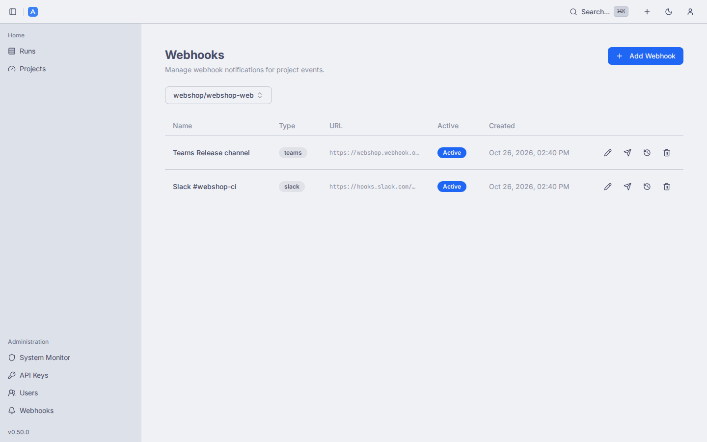
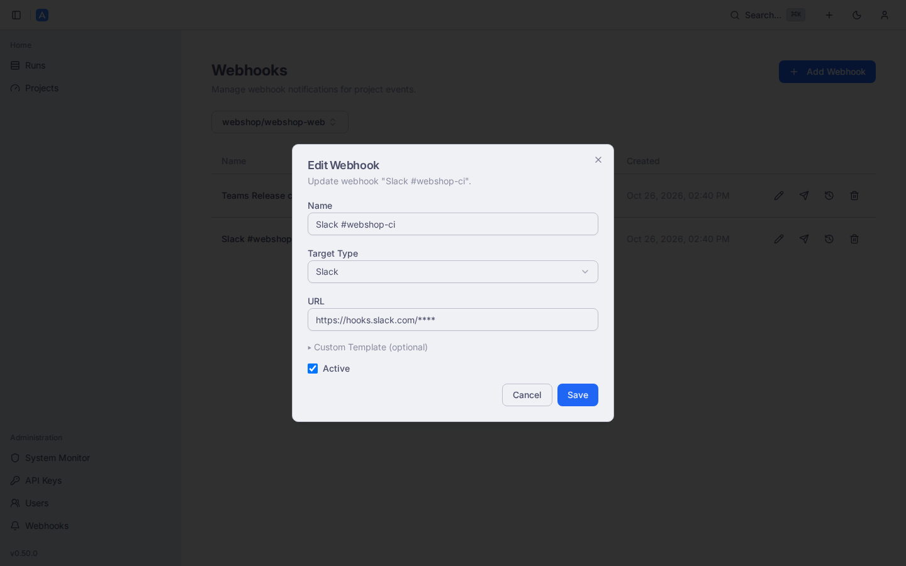

# Webhooks

Webhooks send outbound HTTP notifications when report generation finishes, a report job fails, a defect regresses, or a daily regression digest is due. Use them to post test results to Slack, Discord, Microsoft Teams, or any custom HTTPS endpoint.

Related documentation: [Features](features.md) · [Configuration Reference](configuration.md)

---

## Table of Contents

1. [Overview](#overview)
2. [Supported Targets](#supported-targets)
3. [Events](#events)
4. [Creating and Editing Webhooks](#creating-and-editing-webhooks)
5. [Payload Shape](#payload-shape)
6. [Target-Specific Examples](#target-specific-examples)
7. [Delivery and Retry](#delivery-and-retry)
8. [Security](#security)
9. [API Reference](#api-reference)

---

## Overview



Webhooks are managed at **Administration → Webhooks** in the sidebar (`/settings/webhooks`). The link is visible to editor and admin users only (viewers cannot manage webhooks).

Each webhook:
- Belongs to one project (selected via the project picker at the top of the page)
- Subscribes to one or more [events](#events) (the UI always creates webhooks with `report_completed`; other events are set through the API)
- Has a **target type** that controls the payload format
- Can be toggled active/inactive without deleting it
- Is limited to **10 per project**

Webhook delivery is handled by a dedicated River worker queue (`webhooks` queue, 5 concurrent workers) to keep notification failures isolated from report generation.

---

## Supported Targets

| Target type | Description |
|-------------|-------------|
| `slack` | Slack Incoming Webhook URL — payload rendered as a Slack Block Kit message |
| `discord` | Discord channel webhook URL — payload rendered as a Discord embed |
| `teams` | Microsoft Teams Incoming Webhook URL — payload rendered as a Teams MessageCard |
| `generic` | Any HTTPS endpoint — receives a signed JSON payload |

---

## Events

| Event | Sent when |
|-------|-----------|
| `report_completed` | A report finishes generating (every build) |
| `report_failed` | A report finishes generating and the build has at least one failed test, or a report job fails after exhausting its retries |
| `regression_detected` | A report finishes generating and at least one defect regressed in that build. The payload carries a `regressions` array |
| `digest` | Once every 24 hours, for each project that had a defect regression in the previous 24 hours. The payload carries a `digest` object instead of build stats |

A webhook may subscribe to several events, but each build produces **one** delivery per webhook: the most specific triggered event it subscribes to wins, in the order `regression_detected` > `report_failed` > `report_completed`. A webhook that subscribes to `report_completed` also receives the minimal `report_failed` payload when a report job fails permanently.

A webhook created without `events` defaults to `["report_completed"]`. The web UI has no events selector, so set `events` through the [API](#api-reference) to subscribe to anything else. An unknown event name is rejected with `400`.

---

## Creating and Editing Webhooks



Click **Add webhook** (or the edit icon on an existing webhook) to open the webhook form.

**Fields:**

| Field | Required | Description |
|-------|----------|-------------|
| **Name** | Yes | Display label (max 100 characters) |
| **Project** | Yes | Chosen with the project picker on the Webhooks page before you click **Add webhook**. Report events for this project trigger the webhook |
| **Target type** | Yes | One of: `slack`, `discord`, `teams`, `generic` |
| **URL** | Yes | The webhook endpoint URL. Must use `http` or `https`. Private/loopback addresses are rejected (SSRF prevention) |
| **Secret** | No | (`generic` only) HMAC-SHA256 signing secret. When set, every delivery includes a `X-AllureDeck-Signature` header with the hex-encoded HMAC of the request body |
| **Custom template** | No | Override the default payload body with a custom template (collapsed under **Custom Template (optional)**) |
| **Active** | — | Toggle — inactive webhooks receive no deliveries |

**Events** are not part of the form. To subscribe a webhook to `report_failed`, `regression_detected`, or `digest`, send `events` in the create or update API request (see [Events](#events)).

**Test delivery:** Each webhook row has a **Send test delivery** action that calls `POST .../webhooks/{webhook_id}/test`. The endpoint currently only confirms that the webhook exists and acknowledges the request; it does not send a request to your URL. Verify the endpoint with a real build and check the [delivery history](#delivery-and-retry).

---

## Payload Shape

All webhook deliveries send a JSON payload with the following top-level structure (exact rendering varies by target type — `slack`, `discord`, and `teams` targets render this as their respective message format; `generic` targets receive it directly). `event` carries the [event](#events) that triggered the delivery.

**Generic JSON payload:**

```json
{
  "event": "report_completed",
  "project_id": 7,
  "build_number": 42,
  "timestamp": "2026-05-10T21:02:34Z",
  "dashboard_url": "https://alluredeck.example.com/projects/7/reports/42",
  "stats": {
    "total": 500,
    "passed": 480,
    "failed": 12,
    "broken": 3,
    "skipped": 5,
    "pass_rate": 96.0
  },
  "delta": {
    "pass_rate_change": 1.5,
    "new_failures": 2,
    "fixed_tests": 5
  },
  "ci": {
    "provider": "GitHub Actions",
    "build_url": "https://github.com/org/repo/actions/runs/123",
    "branch": "main",
    "commit_sha": "abc1234"
  }
}
```

`delta` is omitted when there is no previous build to compare against. `ci` is omitted when no CI metadata was provided on upload. `dashboard_url` is only populated when `EXTERNAL_URL` is configured.

Additional fields appear for some events:

| Field | Present on | Contents |
|-------|-----------|----------|
| `slug` | `digest` | Project slug |
| `regressions` | any build event (`report_completed`, `report_failed`, `regression_detected`) | Array of `{fingerprint_id, message, category, occurrence_count}`, one per defect that regressed in the build. Present whenever the build has regressions, whichever event the webhook receives |
| `digest` | `digest` | `{period_start, period_end, regression_count, regressions}` for the trailing 24 hours |

A `report_failed` delivery for a failed report job is minimal: it carries `event`, `project_id`, and `timestamp`, plus `build_number: 0` and an all-zero `stats` object (those two fields are not omitted).

---

## Target-Specific Examples

### Slack

Set `target_type: slack` and paste an [Incoming Webhook URL](https://api.slack.com/messaging/webhooks) from your Slack App configuration. AllureDeck renders a Block Kit message with pass rate, test counts, and a link to the report.

```bash
curl -X POST https://alluredeck.example.com/api/v1/projects/7/webhooks \
  -H "Authorization: Bearer $TOKEN" \
  -H "Content-Type: application/json" \
  -d '{
    "name": "Slack #test-results",
    "target_type": "slack",
    "url": "https://hooks.slack.com/services/T00/B00/xxxx",
    "events": ["report_completed"]
  }'
```

### Discord

Set `target_type: discord` and use a Discord channel webhook URL (Channel Settings → Integrations → Webhooks). AllureDeck renders a Discord embed with colour-coded pass rate.

```bash
curl -X POST https://alluredeck.example.com/api/v1/projects/7/webhooks \
  -H "Authorization: Bearer $TOKEN" \
  -H "Content-Type: application/json" \
  -d '{
    "name": "Discord #ci-reports",
    "target_type": "discord",
    "url": "https://discord.com/api/webhooks/1234/xxxx",
    "events": ["report_completed"]
  }'
```

### Microsoft Teams

Set `target_type: teams` and use an Incoming Webhook connector URL from a Teams channel. AllureDeck renders a MessageCard with an action button linking to the report.

```bash
curl -X POST https://alluredeck.example.com/api/v1/projects/7/webhooks \
  -H "Authorization: Bearer $TOKEN" \
  -H "Content-Type: application/json" \
  -d '{
    "name": "Teams - QA Notifications",
    "target_type": "teams",
    "url": "https://your-org.webhook.office.com/webhookb2/xxx",
    "events": ["report_completed"]
  }'
```

### Generic HTTP

Set `target_type: generic` to receive the raw JSON payload at any HTTPS endpoint. Optionally set a `secret` to enable HMAC-SHA256 request signing.

```bash
curl -X POST https://alluredeck.example.com/api/v1/projects/7/webhooks \
  -H "Authorization: Bearer $TOKEN" \
  -H "Content-Type: application/json" \
  -d '{
    "name": "My CI system",
    "target_type": "generic",
    "url": "https://ci.example.com/hooks/alluredeck",
    "secret": "my-signing-secret",
    "events": ["report_completed"]
  }'
```

When a secret is set, each delivery includes:

```
X-AllureDeck-Signature: sha256=<hex-encoded HMAC-SHA256 of body>
```

Verify on your server:

```python
import hmac, hashlib
expected = hmac.new(b"my-signing-secret", body, hashlib.sha256).hexdigest()
assert hmac.compare_digest(f"sha256={expected}", request.headers["X-AllureDeck-Signature"])
```

---

## Delivery and Retry

Deliveries are attempted up to **5 times** with exponential backoff. Each attempt is recorded in the delivery log.

**View delivery history:** Click the history icon on a webhook row. Each entry shows:
- HTTP status code
- Response body (truncated)
- Error message (on failure)
- Attempt number
- Duration in milliseconds
- Delivery timestamp

Entries are ordered newest first and paginated (20 per page).

---

## Security

- **URLs are masked** in API responses: `https://hooks.slack.com/****`. The full URL is never returned after creation.
- **Secrets are never returned** from the API. The `has_secret` boolean indicates whether a secret is set.
- **URLs are stored encrypted** at rest using AES-GCM.
- **SSRF prevention at save time:** The server validates webhook URLs before saving. Private IP ranges (RFC 1918), loopback addresses (`127.0.0.1`, `::1`, `localhost`), and link-local addresses are rejected.
- **SSRF prevention at delivery time:** Every delivery resolves the hostname again and refuses to connect if any resolved address is loopback, private, link-local, or unspecified (including IPv4-mapped IPv6 forms). The connection is pinned to the address that passed the check, so a DNS record that changes after the webhook was saved cannot redirect a delivery to an internal host. Redirects are re-checked the same way, and a chain of five or more redirects is refused.
- **Access control:** Creating, editing, and deleting webhooks requires editor or admin role. The sidebar link to the Webhooks page is hidden from viewer accounts.

---

## API Reference

All webhook endpoints require editor or admin role.

| Method | Path | Description |
|--------|------|-------------|
| `GET` | `/api/v1/projects/{project_id}/webhooks` | List all webhooks for a project |
| `POST` | `/api/v1/projects/{project_id}/webhooks` | Create a webhook (max 10 per project). Accepts `events` (`report_completed`, `report_failed`, `regression_detected`, `digest`); defaults to `["report_completed"]` |
| `GET` | `/api/v1/projects/{project_id}/webhooks/{webhook_id}` | Get a single webhook (URL masked) |
| `PUT` | `/api/v1/projects/{project_id}/webhooks/{webhook_id}` | Update a webhook (partial update — omit fields to leave unchanged, including `events`) |
| `DELETE` | `/api/v1/projects/{project_id}/webhooks/{webhook_id}` | Delete a webhook |
| `POST` | `/api/v1/projects/{project_id}/webhooks/{webhook_id}/test` | Acknowledge a test request (see [Creating and Editing Webhooks](#creating-and-editing-webhooks)) |
| `GET` | `/api/v1/projects/{project_id}/webhooks/{webhook_id}/deliveries` | Paginated delivery history. Query params: `page`, `per_page` |
